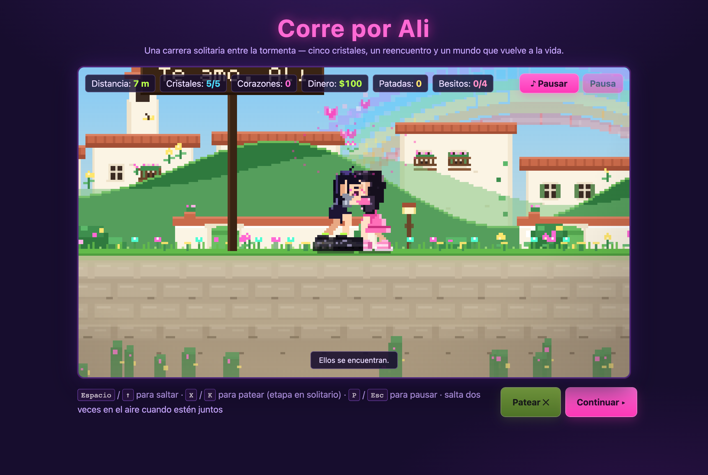
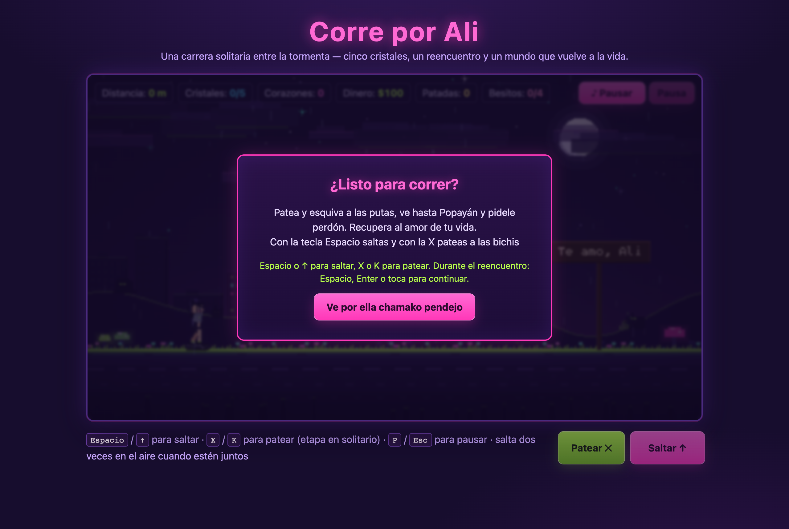
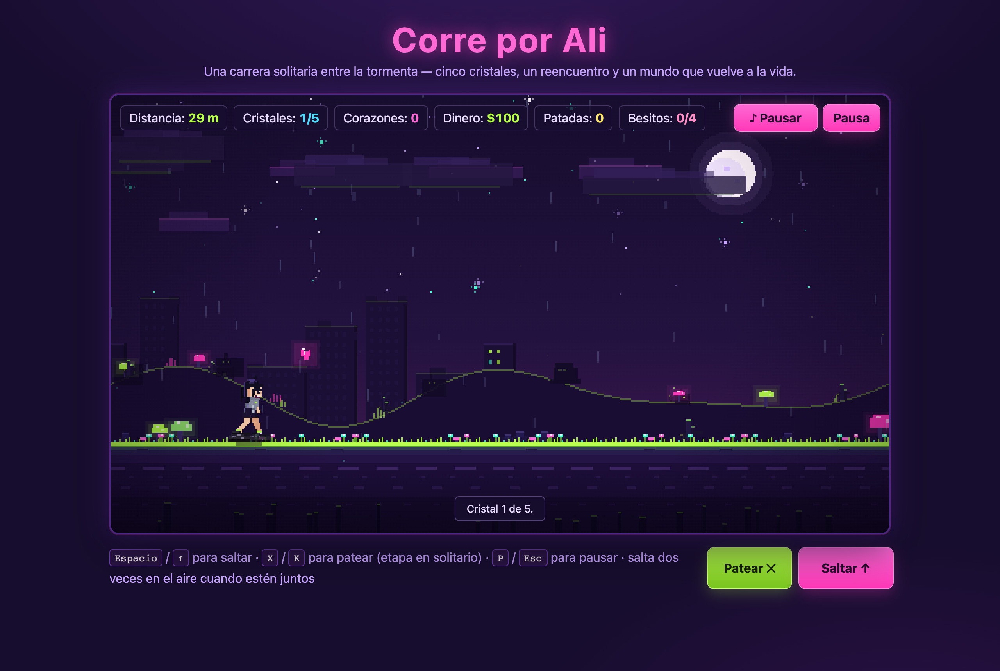
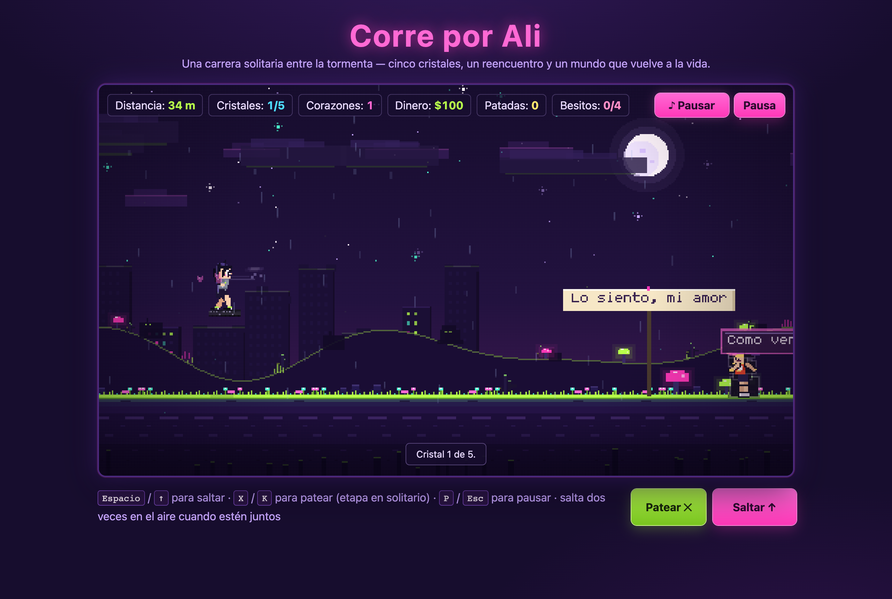
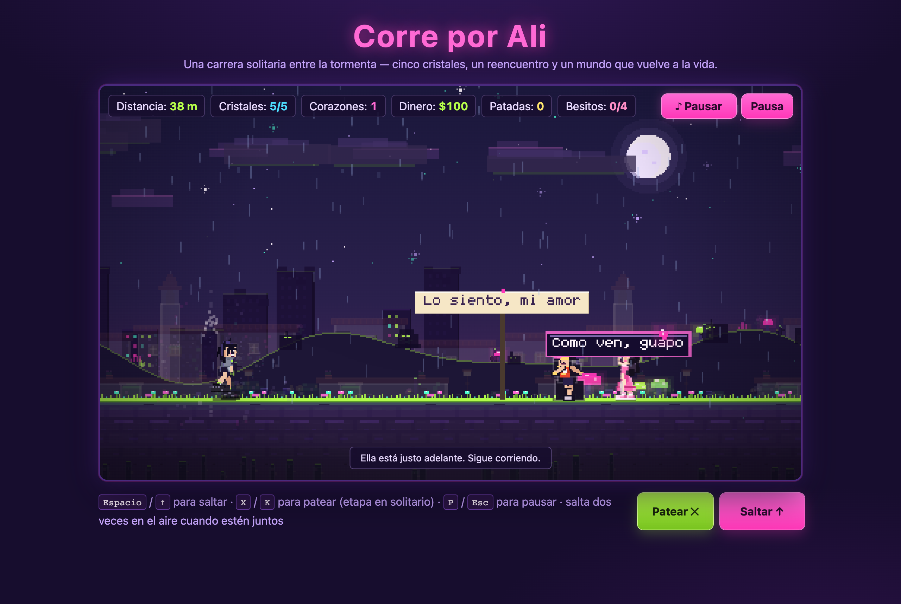
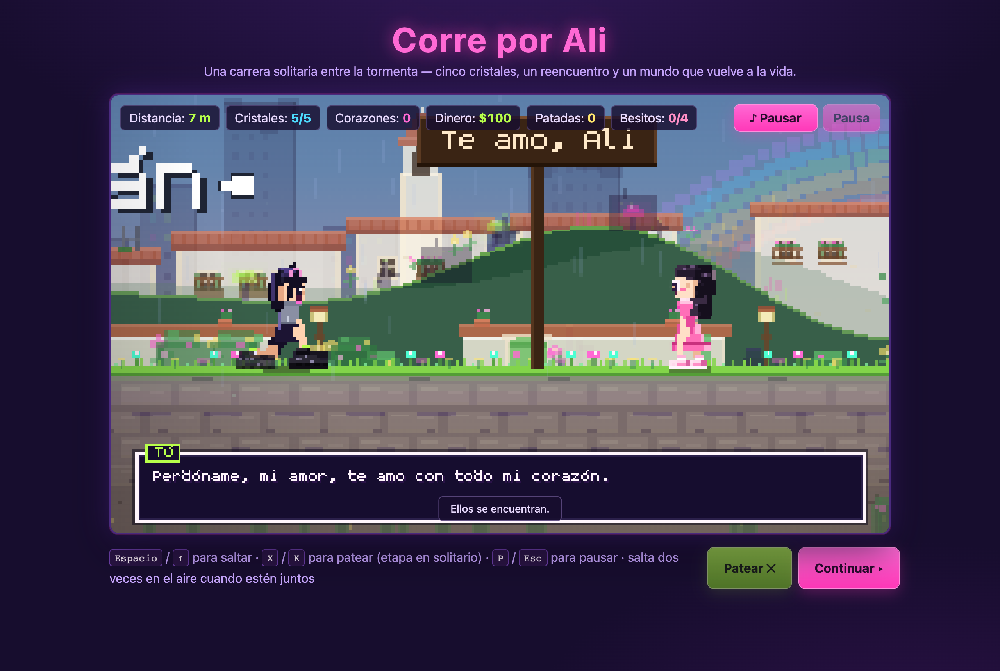
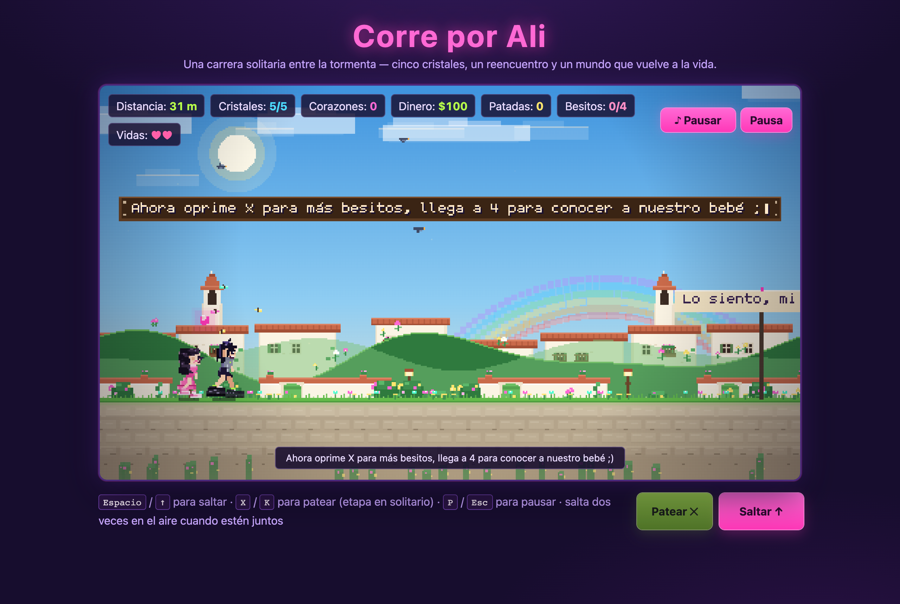
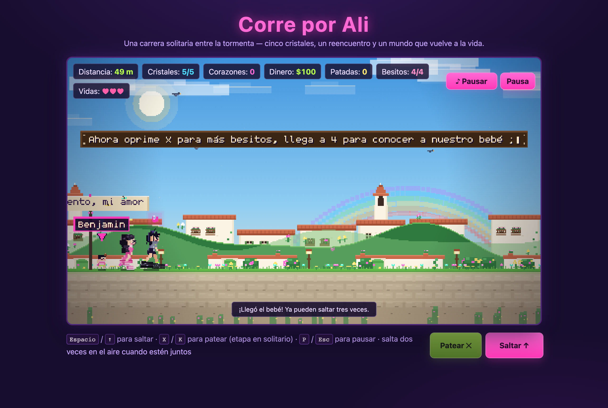
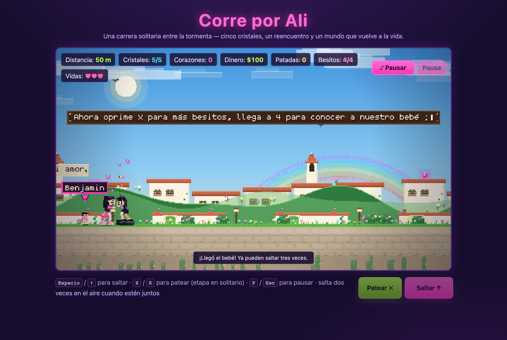
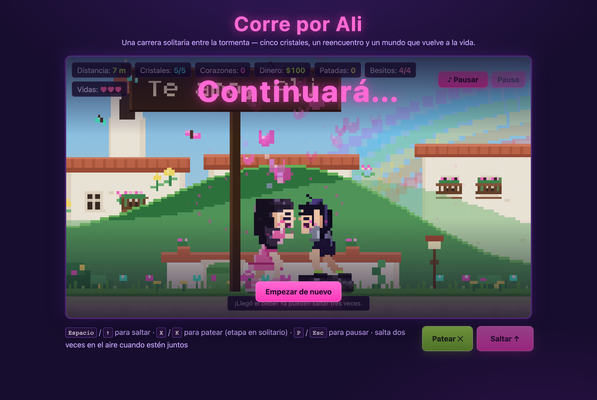

# Corre por Ali · Run for Ali

> A stormy pixel-art runner about a long walk home.
> Samuel runs alone through the rain, collects **five crystals**, finds Ali
> waiting in the white colonial streets of Popayán — and then has to survive
> the family he asked for.

**Play it now → https://devdevsamuel.github.io/project-ali/**



---

## Table of contents

- [What the game is](#what-the-game-is)
- [Screenshots](#screenshots)
- [Installation](#installation)
- [Running the game](#running-the-game)
- [Controls](#controls)
- [Game modes and systems](#game-modes-and-systems)
- [Project structure](#project-structure)
- [Tests](#tests)
- [Deployment](#deployment)
- [License](#license)

---

## What the game is

**Corre por Ali** (a.k.a. *Run for Ali*) is a browser-based, side-scrolling
pixel-art runner written in plain JavaScript on a single `<canvas>`. No engine,
no framework, no runtime dependencies — just Vite for the dev server and the
browser's own `Audio` API for the soundtrack.

The run has three acts:

1. **The storm (solo).** Samuel runs through a neon-lit ruin in the rain.
   Bichis (rival characters) block the road and can be jumped or kicked; signs
   along the way carry the messages he left for Ali. Collect the **five
   crystals** to open the way.
2. **The reunion (cinematic).** The storm clears into a bright colonial
   city. Ali is waiting down the road. The game cuts the camera in, Samuel
   kneels, and the two of them talk through seven dialogue beats before
   sharing a kiss.
3. **The family (couple running).** They run together through the sunny
   streets, now with **three lives** shared between them, a **kiss counter**,
   a **baby** named Benjamin, and — once he joins — **guerrillas** throwing
   chancletas at the happy couple.

---

## Screenshots

Every image below is a real frame captured from the running game with
Playwright driving Chrome against the production build.

| | |
|---|---|
|  |  |
| **The menu** — *¿Listo para correr?* | **The solo run** — rain, signs and the neon ruins |
|  |  |
| **The kick** — the impact lands with a hit-stop and a quip | **Five crystals** — the counter that opens the way to her |
|  |  |
| **The reunion** — a Pokémon-style dialogue box | **The kiss** — the cinematic the whole run is about |
|  |  |
| **The couple run** — sunny streets, one shared jump | **Benjamin** — the arrow and the name that points him out |
|  |  |
| **A kiss while running** — press `X` | **Continuará...** — the secret ending |

---

## Installation

**Requirements:** [Node.js](https://nodejs.org) 22 or newer (the CI uses Node
22) and npm. There is nothing else to install — the game has **no runtime
dependencies**, and the only dev dependency is Vite.

```bash
# 1. Get the code
git clone https://github.com/devdevsamuel/project-ali.git
cd project-ali

# 2. Install the dev dependencies (Vite only)
npm ci        # or: npm install

# 3. Start the dev server
npm run dev
```

Vite prints the local address, usually:

```
➜  Local:   http://localhost:5173/project-ali/
```

Open it in a browser. If you prefer to see the exact production output, use
the preview server instead:

```bash
npm run build     # bundles the game into dist/
npm run preview   # serves dist/ locally
```

> The `base: '/project-ali/'` setting in `vite.config.js` exists because the
> site is published under a sub-path on GitHub Pages. The dev server serves
> `index.html` from the root, so everything works without extra configuration.

---

## Running the game

| Script | What it does |
|---|---|
| `npm run dev` | Dev server with hot reload at `http://localhost:5173/project-ali/` |
| `npm run build` | Production bundle in `dist/` (the exact files Pages publishes) |
| `npm run preview` | Serves the built `dist/` locally, like production |
| `npm test` | Runs the whole test suite with the Node test runner |

### Useful debug flags

Append them to the URL while developing:

| Flag | Effect |
|---|---|
| `?autostart` | Skips the menu and starts the run |
| `?demo` | Attract mode: the runner plays itself |
| `?crystals=4` | Pre-collects crystals to jump straight to the reunion |
| `?distance=180` | Fast-forwards to a distance in metres |
| `?t=12` | Fast-forwards the simulation by N seconds |
| `?kick=0.12` | Jumps into a kick to inspect the impact |
| `?robbery=3` | Fast-forwards the thief encounter |
| `?kisses=4` | Fakes kisses so the baby can be inspected |

---

## Controls

| Action | Desktop | Mobile |
|---|---|---|
| Jump | `Space` or `↑` | **Saltar** button (double-tap in the air for the second jump) |
| Kick (solo stage) | `X` or `K` | **Patear** button |
| Kiss (couple stage) | `X` or `K` | **Patear** button (the same key becomes a kiss) |
| Advance a dialogue line | `Space`, `Enter` or `X` | **Continuar** button, or tap the canvas |
| Pause | `P` or `Esc` | **Pausa** button |
| Mute the music | — | **♪ Pausar** button |

The jump input is shared: one press moves every character that is still
alive, and a second press in mid-air is the double jump. The third jump only
unlocks once the baby has joined the family.

---

## Game modes and systems

- **Five crystals.** The reunion only unlocks after the fifth one. The
  counter in the HUD, the sign messages along the road and the story beats
  all follow the same number.
- **The reunion cinematic.** A dedicated state: the world freezes, the camera
  cuts into a close crop, and seven dialogue beats play out — one line per
  press, with Ali's deliberate silence in the middle. The kiss reuses the same
  animation code as the couple-stage kiss.
- **The life system.** In the couple stage the family shares lives: two to
  start, three once the baby joins. They are always lost in the same order —
  Samuel first, then Ali, then the baby — and a single hit can never take two
  lives at once. The hearts in the HUD show how many are left.
- **The kiss counter.** Pressing `X` while the couple runs shares a kiss
  instead of a kick. Only a kiss that finishes counts.
- **Benjamin.** After four kisses the baby trots in at the speed of the road,
  jumps and double-jumps with the family, and is pointed out by a temporary
  arrow and name label. His arrival unlocks the triple jump.
- **The guerrilla event.** Once the baby has joined, a short warning is
  followed by a survival encounter against pixel-art fighters who throw
  chancletas. Surviving the first five seconds is a milestone, not the end:
  the fight keeps going until the family is genuinely finished.
- **The secret ending.** A separate, stable state with its own camera crop,
  a kiss and the title *Continuará...*. It has its own restart control and
  never lets the gameplay keys leak back into the run.
- **Audio.** Two background songs (`Sin Ti` for the storm, `Contigo` for the
  city), a kick impact sound and the recorded dialogue voices. The voices are
  currently muted behind a single flag — see
  `ENABLE_DIALOGUE_VOICES` in `src/game/config.js`. The written dialogue,
  the music and the sound effects are unaffected.

---

## Project structure

```
project-ali/
├── index.html            # page shell, HUD and overlays
├── vite.config.js        # base path for GitHub Pages
├── docs/images/          # the screenshots used in this README
├── src/
│   ├── main.js           # DOM wiring: HUD, buttons, audio toggle
│   ├── style.css         # the whole visual identity
│   └── game/
│       ├── Game.js       # state machine: solo, reunion, couple, ending
│       ├── Player.js     # Samuel: run, jump, kick, death
│       ├── Girl.js       # Ali: the shared run and the double jump
│       ├── Baby.js       # Benjamin: the newest member of the family
│       ├── Input.js      # keyboard handling
│       ├── Obstacle.js   # couple-stage street hazards
│       ├── Rival.js      # the kickable "bichis" of the solo stage
│       ├── Guerrilla.js  # the survival event's fighters
│       ├── Robber.js     # the thief that steals the cash
│       ├── Crystal.js    # the five collectible crystals
│       ├── Signs.js      # the messages left along the road
│       ├── Comments.js   # the speech bubbles of the rivals
│       ├── Effects.js    # particles: impacts, sparkles, hearts
│       ├── Environment.js# parallax world, weather and the city
│       ├── City.js       # the colonial street backdrop
│       ├── Weather.js    # rain and lightning
│       ├── Life.js       # birds and butterflies
│       ├── dialogue.js   # the reunion script (content only)
│       ├── dialogueRender.js # the dialogue window
│       ├── font.js       # the 5x9 pixel font
│       ├── Audio.js      # the centralized audio manager
│       ├── characterSpec.js  # shared rig and poses
│       ├── characterRender.js# shared rig renderer
│       ├── render.js     # the pixel buffer and the camera cut
│       ├── physics.js    # shared vertical movement
│       ├── config.js     # every tunable value in one place
│       └── palette.js    # the colour palette
└── tests/                # Node test-runner suites
```

---

## Tests

The suite runs on the Node test runner — no browser and no extra dependency:

```bash
npm test
```

It covers the progression (five crystals), the dialogue beats, the audio
lifecycle, the kiss counter, the life system and its death order, the
guerrilla encounter, the baby (speed, jumps, marker) and the ending.

---

## Deployment

The site is published to GitHub Pages by
[`.github/workflows/deploy.yml`](.github/workflows/deploy.yml): every push to
`main` runs the tests, builds `dist/` and publishes it. You can also re-run
it from the Actions tab.

**Live site:** https://devdevsamuel.github.io/project-ali/

See [DEPLOY.md](DEPLOY.md) for the workflow, the required permissions and
troubleshooting.

---

## License

Made for Ali. The code is yours to reuse; the pixel art, the music and the
recordings belong to the project.
